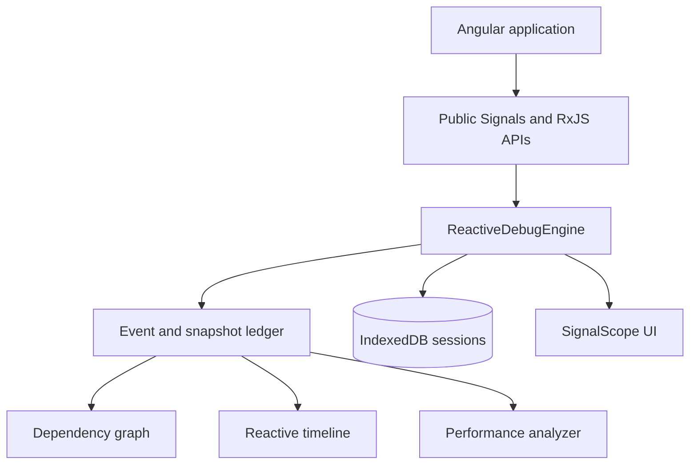
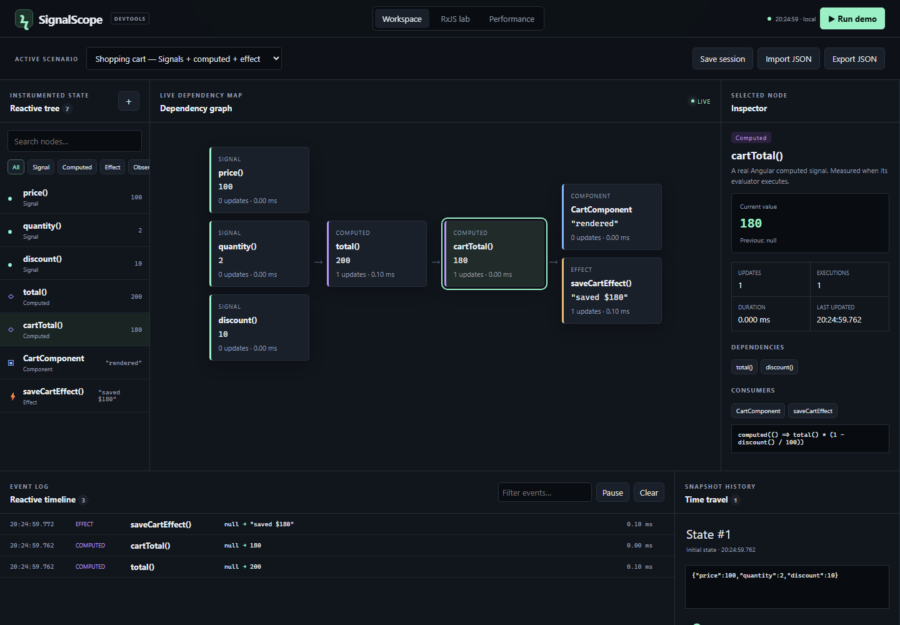

# SignalScope

## Angular Reactive State Debugger

SignalScope is an interactive developer tool for understanding Angular Signals and RxJS flows. It turns declared reactive dependencies, state transitions, observable emissions, snapshots, and execution timings into a workspace that feels closer to browser tooling than a tutorial application.

> SignalScope uses Angular's supported public APIs. Angular performs the real `signal()`, `computed()`, `effect()`, `linkedSignal()`, and `toSignal()` work. SignalScope adds an explicit instrumentation and simulation layer; it does not read undocumented Angular internals.

## Problem

Modern Angular applications often mix synchronous Signals with asynchronous RxJS pipelines. As an application grows, it becomes difficult to answer simple questions: which source triggered a computed value, why did an effect run, what crossed an observable boundary, and which calculation is becoming expensive?

## Solution

SignalScope provides a visual sandbox where developers can edit writable state and immediately inspect the dependency graph, event timeline, current and previous values, execution timings, snapshots, and RxJS operator stages.

## Features

- Interactive dependency graph with Signals, computed values, effects, observable stages, API events, and components
- In-app playground for creating typed writable Signals and editing them through the inspector
- Inspector with writable value controls, dependencies, consumers, previous values, update counts, and timings
- Searchable reactive timeline with pause, clear, filtering, and replay
- Time travel across a bounded history of 120 immutable snapshots
- Real RxJS search pipeline using `debounceTime()`, `distinctUntilChanged()`, `switchMap()`, error recovery, and `shareReplay()`
- Performance ranking, repeated-result detection, and dependency cycle detection
- Four zero-configuration scenarios: shopping cart, search, live analytics, and 25,000-record filtering
- IndexedDB session storage plus validated JSON import and export, including custom playground Signals
- Accessible controls, focus styles, live announcements, semantic regions, and responsive layouts
- Dedicated Web Worker entry point for heavy numeric analysis

## Architecture



The core separates framework-aware orchestration from pure debug bookkeeping. `ReactiveDebugEngine` owns registered Angular reactive primitives. `DebugLedger` is a deterministic, independently tested event, graph, snapshot, and metric model. Scenario setup and persistence remain separate services, while UI components consume immutable projections through Signals.

## Angular concepts demonstrated

- Standalone components and strict TypeScript
- `signal()`, `computed()`, `effect()`, `linkedSignal()`, and `toSignal()`
- Signal and RxJS interoperability
- OnPush change detection and built-in control flow
- Angular CDK accessibility announcements
- Dependency injection and global error handling
- Lazy, asynchronous work through RxJS and a Web Worker

## Signals vs RxJS

Signals suit synchronous application and UI state: selections, filters, themes, current values, and derived state. RxJS suits events over time: HTTP, WebSockets, debounced input, cancellation, retries, and concurrent async work. SignalScope uses each at its natural boundary and visualizes how a value moves between them.

## Demo

Open the application and press **Run demo**. The active scenario changes writable state, recalculates computed values, runs effects or stream operators, updates the graph and timeline, and captures state history automatically. Switching scenarios resets the workspace to a coherent example.

## Screenshots



## Performance

The event ledger retains the newest 12,000 events and 120 snapshots. UI lists use Angular's keyed `@for` blocks. Execution durations and unchanged computed evaluations are aggregated without a third-party state library. The production bundle remains below Angular's configured initial budget.

## Testing

Unit tests cover node registration, dependency edges, bounded timeline behavior, immutable snapshots, cycle detection, and performance metrics. Playwright covers the recruiter demo, the RxJS search flow, and the performance view.

```bash
npm test
npm run test:coverage
npm run e2e
```

## Installation

Requirements: Node.js 22.12+ or 24+, and npm.

```bash
npm install
npm start
```

Open `http://127.0.0.1:4200`.

## Development

```bash
npm start
npm run build
npm test
```

The source follows a feature-oriented layout under `src/app`: core models, services and utilities; feature components; shared presentation helpers; and Web Workers.

## Future roadmap

- Adapter package for opt-in instrumentation inside a host Angular application
- Import validation and schema migration for exported sessions
- Canvas graph pan, zoom, and automatic layout for hundreds of nodes
- Marble-style virtual time controls for RxJS pipelines
- Chrome DevTools extension transport
